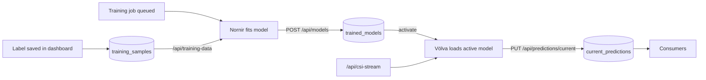

# Grimnir ML pipeline

> **Summary:** A person labels time ranges with a room, Nornir fits a random
> forest on per-window statistics of the labeled CSI, and Völva applies the
> active model to the live stream and publishes which rooms look occupied.
> The pipeline works end to end, but it's a baseline: it names one room per
> receiver and has no way to say "nobody home".

## Flow

A label copies CSI rows into the training set. A queued job tells Nornir
which time range and rooms to train on. The uploaded model does nothing until
someone activates it in the dashboard, and then Völva picks it up and starts
publishing predictions.

One part of this flow doesn't work as drawn: a job that was cancelled, or
failed by the orphan reaper, keeps training and still uploads its model
([#106](https://github.com/dannysauer/grimnir/issues/106)).

## Labels

A label is a time range, a room, and an occupant count. Training uses only
the room name. The occupant count includes pets and never reaches the trainer
([#14](https://github.com/dannysauer/grimnir/issues/14)). `empty` is an
ordinary room name, not a separate "nobody here" state.

## Features

Both services call `csi_models.features.extract_features`, so training and
inference compute the same thing. The
[feature extraction record](../adrs/2026-04-18-shared-versioned-feature-extraction.md)
covers why.

A window is a run of consecutive rows from one receiver. The extractor takes
the mean and variance of each subcarrier's amplitude across the window and
returns them as one vector. Phase is off by default, because raw phase carries
hardware offsets that nothing removes yet
([#7](https://github.com/dannysauer/grimnir/issues/7)).

`feature_config` travels with each model and records the extractor version,
the statistics, and whether amplitude and phase were used. It doesn't record
the window size. Nornir takes that from the job's hyperparameters, default 50
rows, and Völva takes it from `WINDOW_SIZE`, also default 50
([#61](https://github.com/dannysauer/grimnir/issues/61)).

## Training

Nornir is a claim loop. It registers with Freki by heartbeat, claims the
oldest queued job it can see, and pages the labeled rows for the job's time range and
rooms. It builds windows per receiver, pools the windows from all receivers
into one dataset, and fits a scikit-learn `RandomForestClassifier` whose
classes are room names.

It holds out a random 20% of the windows and reports accuracy and macro F1 on
them. Adjacent windows are nearly identical, so those numbers run high
([#61](https://github.com/dannysauer/grimnir/issues/61)).

The model is serialized with joblib and uploaded with its metrics and
`feature_config`. While a job runs, Nornir heartbeats it. Freki fails a
running job whose heartbeat goes stale and queues it again
([#85](https://github.com/dannysauer/grimnir/issues/85)).

## Inference

Völva polls Freki for the active model and swaps it in when the id changes.
It refuses a model whose `feature_config.version` differs from its own
`FEATURE_VERSION`, and keeps serving the previous model when a refresh fails.

It follows `/api/csi-stream` and keeps a sliding window per receiver. Each
full window yields one predicted room for that receiver. Völva keeps the last
five predictions per receiver, takes each receiver's most common one, and
reports `human_count: 1` for every room that some receiver chose and `0` for
the rest.

It publishes to `PUT /api/predictions/current` only when the result changes.
A reader can't tell a prediction that's still true from one published before
Völva stopped.

`/health` returns `503` when the model-refresh loop or the inference loop has
stopped.

## What the pipeline can't do yet

- It can't report an empty house. With no `empty` training data the
  classifier always picks a room, and with it, `empty` shows up as an occupied
  room.
- It can't place two people. Each receiver votes for one room, and the votes
  are merged, so a second "occupied" room usually means two receivers
  disagreed.
- It can't tell a pet from a person, or one person from another.
- It can't measure anything periodic, such as breathing. Window statistics
  throw away the time series, and the samples have no capture timestamps.

The [sensing roadmap](../design/2026-11-15-sensing-roadmap.md) design doc
covers what would have to change for each of these.
[#110](https://github.com/dannysauer/grimnir/issues/110) tracks the empty
state and prediction expiry.
