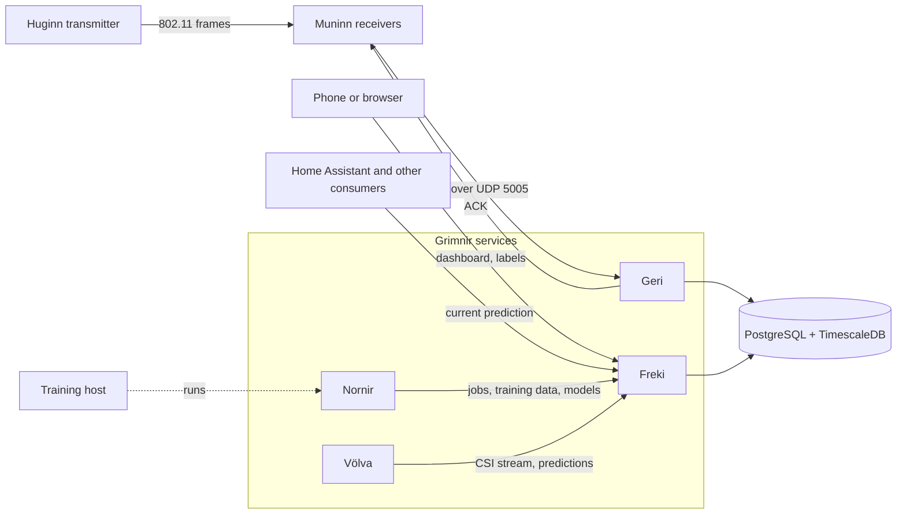

# Grimnir architecture

> **Summary:** Grimnir infers which rooms of a house are occupied from Wi-Fi
> channel state information (CSI) captured by ESP32-S3 boards, with no
> cameras. Receivers stream CSI over UDP to a small set of Python services
> that store it in TimescaleDB, collect room labels from a phone, train a
> classifier, and publish live room predictions. Two choices shape the rest:
> PostgreSQL is the only shared state, and the ML services reach data only
> through the Freki API.

## Purpose

Grimnir exists to answer "who is where" on one property without putting a
camera or microphone in any room. It's a personal system for one household.

The goals, in the order they're expected to arrive:

1. Locate people at room level inside the house.
2. Tell pets from people, and locate pets.
3. Cover the rest of the property.
4. Detect when a person is probably asleep, and where.
5. Estimate respiration rate, and tell specific people apart.

Only the first goal is implemented, and only in a basic form: one classifier
that names a single occupied room. No accuracy target has been set for any
goal. The route from here to the later goals is an open design question; see
[Open questions](#open-questions).

## Context

Huginn transmits frames, and each Muninn receiver measures the CSI of the
frames it hears and sends one UDP datagram per sample to Geri. Geri and Freki
are the only services that touch the database, which runs outside the
deployment. A person labels time ranges from the dashboard, Nornir trains on
the labeled data, and Völva turns the live stream into a prediction that
consumers read from Freki.

The hardware plan is one transmitter and up to five receivers. Adding a
receiver needs no schema change, because Geri registers each new receiver
name it sees.

Freki has no authentication. Everything it serves is open to any client that
can reach it, so the system belongs on a trusted network only. That's a
deliberate choice for the proof of concept, recorded in
[Defer authentication](../adrs/2026-11-27-defer-authentication.md).

## Building blocks

| Component | Directory | Owns |
| --- | --- | --- |
| Huginn | `firmware/huginn/` | ESP32-S3 transmitter firmware. Sends a frame about every 100 ms for receivers to measure. |
| Muninn | `firmware/muninn/` | ESP32-S3 receiver firmware. Captures CSI from Huginn's frames, sends it to Geri, and resets its UDP connection when Geri stops acknowledging. |
| Geri | `geri/` | UDP listener. Parses packets, registers new receivers, records heartbeats, and batch-writes samples. |
| Mimir | `mimir/` | The `csi-models` package: SQL migrations, SQLAlchemy models, and the shared feature extractor. |
| Freki | `freki/` | FastAPI service. Serves the dashboard, REST and SSE endpoints, the training-job queue, the model registry, and the current prediction. |
| Nornir | `nornir/` | Training daemon. Claims a job, pulls labeled data from Freki, fits a model, and uploads it. |
| Völva | `volva/` | Inference service. Loads the active model, follows Freki's CSI stream, and publishes the current prediction. |
| Hlidskjalf | `hlidskjalf/` | Static dashboard for receiver status, charts, labeling, training jobs, and models. No build step. |
| Bifrost | `bifrost/` | Docker Compose file, Helm chart, and Ansible playbooks. |

The names come from Norse mythology; [`GRIMNIR.md`](../../GRIMNIR.md) explains
them. The other living pages go deeper:

- [Data model](data-model.md) covers the tables, retention, and migrations.
- [ML pipeline](ml-pipeline.md) covers labels, features, training, and
  inference.
- [Quality attributes](quality-attributes.md) lists the requirements, each
  with an ID that tests cite.

For interfaces, see the [API reference](../api-reference.md), the
[UDP wire protocol](../udp-wire-protocol.md), and the
[metrics reference](../metrics-reference.md).

### Startup

Geri and Freki start the same way. Each applies pending SQL migrations,
creates its async database engine, and then begins serving. Nornir and Völva
need only `FREKI_URL`.

### Cross-cutting conventions

Every Python service logs one JSON object per line through structlog and
exposes Prometheus metrics. Service images build from the repository root,
because each service installs the `mimir/` package first.

## Decisions that shape this design

A change to the design has to respect these Accepted records, or supersede
them with a new one.

- [Apply bundled SQL migrations at service startup](../adrs/2026-04-04-startup-sql-migrations.md)
- [Keep labeled CSI in its own hypertable and expire raw CSI after 14 days](../adrs/2026-04-13-separate-training-samples-retention.md)
- [Train and infer in separate services that reach data only through Freki](../adrs/2026-04-18-ml-services-use-freki-api.md)
- [Share one versioned feature extractor between training and inference](../adrs/2026-04-18-shared-versioned-feature-extraction.md)
- [Gate machine-only ML writes with optional shared secrets](../adrs/2026-04-18-shared-secrets-for-ml-writes.md)
- [Store the current prediction in PostgreSQL](../adrs/2026-04-18-current-prediction-in-postgres.md)
- [Carry CSI over a versioned binary UDP protocol with ACK liveness](../adrs/2026-04-19-udp-wire-protocol-with-ack-liveness.md)
- [Pin GitHub Actions to full release tags](../adrs/2026-04-19-pin-actions-to-release-tags.md),
  with a [proposed replacement](../adrs/2026-11-15-pin-actions-to-commit-shas.md)
- [Defer authentication for the proof of concept, behind one seam](../adrs/2026-11-27-defer-authentication.md)

## Open questions

- **How does the sensing pipeline get from one-room classification to the
  later goals?** The capture format, label schema, and evaluation method all
  have to change first. The
  [sensing roadmap](../design/2026-11-15-sensing-roadmap.md) design doc works
  through the options.
- **How should an AI agent help train models?** The
  [agent training interface](../design/2026-11-15-agent-training-interface.md)
  design doc compares an MCP server with the alternatives.
- **What should training look like in the dashboard?** The
  [training workbench](../design/2026-11-27-training-workbench.md) design doc
  covers the screen and plain-language progress updates written by Claude.
- **How is Freki authenticated, once it is?** Deferred for the proof of
  concept ([record](../adrs/2026-11-27-defer-authentication.md));
  [#5](https://github.com/dannysauer/grimnir/issues/5) lists the candidates.
- **How are release artifacts signed and attested?** Tracked in
  [#3](https://github.com/dannysauer/grimnir/issues/3).
