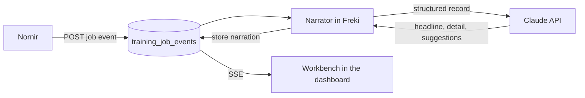

# Design: what does the training workbench show, and how does Claude narrate a run?

> **Summary:** Training happens in two dashboard tabs that show a status pill
> and an accuracy number, and nothing about what's going on in between. The
> leading option is a workbench built on a stream of structured job events:
> data coverage before a run, a live timeline during it, a confusion matrix
> and comparison after it. Claude writes a plain-language version of each step
> and explains the results. The narration is optional, and training never
> waits on it. The model choice and the cost per run are still open.

## Record

| Field | Value |
| --- | --- |
| Date | 2026-11-27 |
| Status | Draft |
| Owner | Danny Sauer |
| Author | Danny Sauer |
| Related | Review epic [#102](https://github.com/dannysauer/grimnir/issues/102); API gaps [#118](https://github.com/dannysauer/grimnir/issues/118); scoring [#111](https://github.com/dannysauer/grimnir/issues/111); dashboard [#69](https://github.com/dannysauer/grimnir/issues/69), [#88](https://github.com/dannysauer/grimnir/issues/88), [#114](https://github.com/dannysauer/grimnir/issues/114); [agent training interface](2026-11-15-agent-training-interface.md) |

## Problem

The Training tab has a form (rooms, a start and end time, a window size) and
a list of the last 30 jobs, each a line of text with a status pill
(`hlidskjalf/index.html:1938-1960`). The Models tab lists models with one
accuracy figure and an activate button (`:2016-2038`). Both poll every ten
seconds.

What a person training a model can't see:

- **Before a run:** how much labeled data each room has, from which
  receivers, and whether any room is too thin to learn.
- **During a run:** what stage it's in, how many rows it's read, or how long
  is left. A job is `running` until it's `complete` or `failed`.
- **After a run:** which rooms the model confuses, whether it beats the
  active model, and what to label next. The only number is accuracy on a
  split that runs high ([#61](https://github.com/dannysauer/grimnir/issues/61)).

The owner also asked whether Claude could describe what's happening in plain
language. A good explanation of a confusion matrix, tied to what to label
next, is worth more than the matrix to someone who isn't an ML practitioner.

## Goals and non-goals

Goals:

- A person can decide whether to start a run, follow it, and decide whether
  to activate the result, all from a phone.
- Every step of a run produces a record a person, the dashboard, or an agent
  can read.
- Claude's narration makes that record easier to understand, and losing it
  loses nothing else.

Non-goals:

- Letting Claude start runs or activate models. That's the
  [agent training interface](2026-11-15-agent-training-interface.md).
- Choosing features or model families. See the
  [sensing roadmap](2026-11-15-sensing-roadmap.md).
- The labeling screen, which changes with the label model in
  [#107](https://github.com/dannysauer/grimnir/issues/107).

## Requirements in scope

- `GRM-020`: a queued job goes to at most one daemon.
- `GRM-021`: a running job with a stale heartbeat is failed.
- `GRM-032`: only the claiming daemon can update a running job. Job events
  posted by Nornir are covered by the same claim token.

Proposed new requirements, to add to the requirements page with real IDs when
this doc is decided:

- Training MUST complete and store its results when narration is turned off
  or Claude is unreachable.
- The narrator MUST NOT send raw CSI, model bytes, or label notes to an
  external service.

## Constraints

- [Train and infer in separate services that reach data only through Freki](../adrs/2026-04-18-ml-services-use-freki-api.md).
  Job events reach Freki over HTTP like everything else Nornir does.
- [Defer authentication, behind one seam](../adrs/2026-11-27-defer-authentication.md).
  New routes declare a scope: `ml:train` for reading and starting runs,
  `ml:control` for Nornir's event posts.
- The dashboard is static files with no build step. The workbench follows the
  module split proposed in [#69](https://github.com/dannysauer/grimnir/issues/69).
- Room and receiver names are untrusted text. Receiver names arrive in
  unauthenticated UDP packets, so anything sent to Claude has to treat them
  as data.

## Options

### Keep the current approach

Two tabs, a status pill, and an accuracy figure. It costs nothing, and none
of the gaps above close.

### Structured job events, templated text only

Nornir posts an event at each stage of a run: claimed, fetching data,
building windows, checking class balance, fitting, evaluating, uploading, and
finished or failed. Each event carries numbers, not prose: rows read so far,
windows per room, the confusion matrix, per-room precision and recall.

Freki stores them in a `training_job_events` table and streams them to the
dashboard. The dashboard turns each event into a sentence from a template:
"Read 48,210 rows from 3 receivers. The bedroom has 4 minutes of data; the
other rooms have at least 30."

This closes every gap above except explanation. Templates can say what
happened, but not what it means or what to do about it.

### Structured events with Claude narration

The same events, plus a narrator in Freki that sends the structured record to
Claude at three points and stores the reply beside the event:

1. **Before a run**, on request: "Here's the data you picked. Here's what's
   likely to go well and what isn't."
2. **At each stage change**, a one- or two-sentence update in plain language.
3. **At the end**, an explanation of the results: which rooms the model
   confuses, why that's plausible given the data, whether it's better than
   the active model, and the two or three labeling sessions most likely to
   help.

Nornir records what happened, Freki stores it, and the narrator adds a
plain-language version when it can. The dashboard always shows the templated
sentence first and replaces it with Claude's version when that arrives.

How the narrator calls Claude:

- The official `anthropic` Python SDK, from the Freki process, as a
  background task that never blocks a request or a training run.
- The response format is set with structured outputs: a headline, a short
  detail paragraph, and a list of suggestions, so the dashboard can lay them
  out without parsing prose.
- The default model is Claude Opus 5.5 (`claude-opus-5-5`) at low effort,
  set by a `NARRATOR_MODEL` variable. A cheaper model such as Claude Haiku 5.5
  would do for the stage updates; that's the owner's call.
- Server-side refusal fallbacks are on, so a declined request is retried on a
  fallback model instead of leaving a gap.
- With no `ANTHROPIC_API_KEY`, or when a call fails, the event keeps its
  templated sentence.

What leaves the house: room names, receiver names, counts, and metrics. Not
raw CSI, not model bytes, and not label notes, which are free text that a
person typed. Names go in a JSON block marked as data, and the reply is
rendered as text, never as HTML.

Cost depends on the model. My estimate, not a measurement: about six calls
per run, each around 2,000 input tokens and 200 output tokens, comes to
roughly seven cents a run on Claude Opus 5.5 and well under a cent on Claude
Haiku 5.5, before thinking tokens, which are billed as output and can't be
turned off on Claude Opus 5.5.

### Let Claude drive training

An agent picks the data, starts runs, reads results, and iterates. That's the
[agent training interface](2026-11-15-agent-training-interface.md), and it
needs the same job events this doc proposes. It's a later step, not an
alternative.

## Comparison

| | Keep current | Templated events | Events with Claude narration |
| --- | --- | --- | --- |
| Shows data coverage before a run | No | Yes | Yes, with a readiness note |
| Shows progress during a run | No | Yes | Yes |
| Shows a confusion matrix and comparison after | No | Yes | Yes |
| Explains results and suggests what to label | No | No | Yes |
| Works with no internet access | Yes | Yes | Yes, without narration |
| Sends data outside the house | No | No | Counts, metrics, and names |
| Running cost | None | None | Cents per run, by model |
| Gives an agent interface something to read | No | Yes | Yes |

## Recommendation

Structured events with Claude narration, built in two steps so the first is
useful alone: events, storage, and the workbench screen with templated text,
then the narrator.

I'm confident about the events. Every option after "keep current" needs them,
and so does the agent interface. I'm less sure how much the narration adds
until it runs against real results; the first version should be easy to turn
off and cheap to change.

The workbench screen, in order of what a person does:

1. **Data.** Labeled minutes per room and per receiver, with rooms below a
   threshold flagged. It needs the dataset summary endpoint in
   [#118](https://github.com/dannysauer/grimnir/issues/118).
2. **New run.** Rooms default to every room with enough data. Time range has
   presets. Model type comes from the options endpoint in #118, not a
   hard-coded string. A "what will this do?" button asks the narrator.
3. **Run.** A timeline of events with a stage progress bar, streamed live.
4. **Results.** The confusion matrix as a heatmap, per-room precision and
   recall, a side-by-side with the active model, the narrator's explanation,
   and an activate button that asks for confirmation.

## Open questions

- **Which model should narrate?** Claude Opus 5.5 by default; Claude Haiku 5.5
  costs far less and may be enough for stage updates. The owner decides, and
  a week of real runs would show whether the cheaper model's explanations
  hold up.
- **Is sending room and receiver names to Anthropic acceptable?** They're
  names like "kitchen". The owner decides; the narrator could replace them
  with placeholders if not.
- **How long should narrations be kept?** With their events, indefinitely, is
  the draft. They're small.
- **Should the workbench be a new page or replace the two tabs?** A new page
  is easier to build alongside the old tabs and drop them later.

## Outcome

Open. No changes of direction yet.
